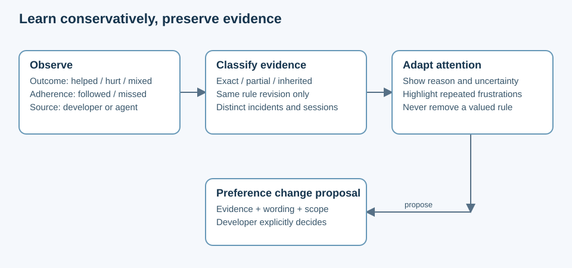

# Proposed library contracts

| State | Compatibility |
|---|---|
| Proposed schema v1; examples are fictional | No existing files, counters or commands changed by this package |

## Basket layout

| Location, relative to the personal basket | Role | Source or derived |
|---|---|---|
| `eggs/`, `chickens/`, `cracked/`, adjacent histories | Existing canonical preferences and lifecycle | Source |
| `library/experiences/YYYY/MM/<uuid>.json` | One immutable incident, amendment or link event | Source |
| `library/runtimes/<uuid>.json` | Immutable runtime observation; corrections append new records | Source |
| `library/policies/attention.json` | Explicit developer settings and attention pins; no applicability overrides | Source |
| `library/sessions/<uuid>/manifest.json` | Context segment, policy/input digests and selected rules | Source |
| `library/views/<session-id>/<segment-id>/ATTENTION.md` | Session-local compiled view | Rebuildable |

All new data belongs in the personal basket, never this tooling repository. Schema examples committed with the tool must be synthetic. Views are excluded from shared exports and may be excluded from git; session manifests and source records remain durable.

## Runtime identity

| Field | Meaning and matching rule |
|---|---|
| `harness.id`, `harness.version`, `harness.surface` | Distinguish product, release and desktop/CLI/etc surface; unknown values stay null |
| `model.provider`, `model.requested_id`, `model.resolved_id` | Preserve alias and actual reported ID separately; an alias is not a resolved revision |
| `model.family`, `model.release` | Explicit recorded classification; never guessed from a name |
| `model.predecessor_runtime_id` | Developer/provider-provenanced relationship; directional hypothesis link |
| `settings.reasoning`, `settings.tools_digest` | Other execution differences worth preserving; null when unavailable |
| `provenance` | Source and certainty per field: harness report, developer supplied or unknown |
| `observed_at`, `id` | UTC timestamp and UUID; context is captured at event time |

Exact-match evidence requires equal known execution fields and a resolved model revision; partial records never become exact through wildcard matching. A later registry update cannot silently reclassify an old observation; an amendment can document a resolved identity while preserving the earlier uncertainty.

## Experience example

| Classification | Example meaning |
|---|---|
| Fictional, positive observation | A reminder helped apply an egg in one context; no general causal proof |

```json
{
  "schema_version": 1,
  "id": "experience-example-001",
  "event": "observed",
  "occurred_at": "2026-10-17T17:00:00Z",
  "recorded_at": "2026-10-17T17:02:00Z",
  "context": {
    "runtime_id": "runtime-example-a",
    "harness": { "id": "harness-placeholder", "version": "release-placeholder", "surface": "cli" },
    "model": { "provider": "provider-placeholder", "requested_id": "family-placeholder-latest", "resolved_id": "model-release-placeholder", "family": "family-placeholder", "release": "version-placeholder" },
    "settings": { "reasoning": null, "tools_digest": null },
    "session_id": "session-example-a",
    "segment_id": "segment-1",
    "task_kind": "design-review"
  },
  "items": [{ "id": "example-rule", "version": 2, "fact_digest": "sha256:example-placeholder", "basket_revision": "git-object-placeholder", "adherence": "followed", "attributed_outcome": "helped", "attribution_source": "developer" }],
  "observation": {
    "outcome": "helped",
    "scenario": "Reviewing a proposal with several choices",
    "result": "The developer found the decision table useful",
    "quote": "That table helped me decide.",
    "attributed_to": "developer",
    "evidence_refs": ["local-session-reference-placeholder"]
  },
  "interpretation": {
    "cause": "The explicit reminder may have improved adherence",
    "attributed_to": "agent",
    "confidence": "hypothesis"
  },
  "exposure": { "attention_manifest_id": "manifest-example-a" },
  "provenance": { "capture": "agent-recorded-developer-feedback", "unknown_fields": ["settings.reasoning", "settings.tools_digest"] }
}
```

Each linked item carries its own `adherence` (`followed`, `missed`, `partial`, `unclear`, or `not-applicable`) and `attributed_outcome` (`helped`, `hurt`, `mixed`, `neutral`, or `unknown`) with attribution source. Incident-level outcome remains separate: one incident may contain a missed sound chicken and a followed harmful egg. Omitted per-item outcomes remain unknown and never copy the incident verdict automatically. A missed rule is evidence about execution, not proof that following the rule hurts. Task type, repository, exposure and other settings can confound comparisons; show evidence coverage and recent contradictions, never a universal model score.

The production writer generates UUIDs and real digests; readable IDs and digest strings above are documentation placeholders. `outcome` accepts `helped`, `hurt`, `mixed`, `neutral`, or `unknown`; a reported result and an inferred cause are separate.

## Incidents, links and corrections

| Record shape | Required behavior |
|---|---|
| `items: []`, developer quote “I had to explain this again” | Valid unlinked frustration; no invented egg or verdict |
| One observation, multiple item references | Count one incident globally; per-item support retains the same incident ID |
| `event: linked`, `supersedes: <experience-id>`, new item references | Add later interpretation; original remains intact |
| `event: amended`, `supersedes: <experience-id>`, corrected fields and reason | Effective view follows explicit correction chain; source bytes remain |
| `event: withdrawn`, `supersedes: <experience-id>`, reason | Exclude from active evidence, keep audit trail |
| Same caller-supplied idempotency key | Return existing record if identical; reject different content |
| Missing or renamed item | Keep item/version/digest reference; resolve through lifecycle history or show unresolved |

No unlinked or ambiguous outcome changes legacy egg counters. Linked contextual observations likewise remain a separate evidence stream in MVP; the existing `feedback` command continues its existing legacy semantics, avoiding a second implicit counter update.

## Compilation and loading contract



| Stage | Deterministic rule |
|---|---|
| Validate | Reject invalid records with diagnostics; keep source intact; never treat stored quotes as executable instructions |
| Select applicable rules | MVP retains every currently installed global live rule and adds attention only; contextual applicability and scoped omission are deferred to a separate canonical-scope plus baseline-render/install design |
| Classify evidence | Exact known runtime first; partial separate; family/predecessor evidence labeled inherited; unknown separate |
| Aggregate | Current item revision only for current-version support; distinct incident IDs and sessions; aggregate per-item attributable outcomes separately from adherence; never count a missed rule as evidence that following it hurt |
| Prioritize | Explicit pins, unresolved repeated harms, declared context focus, then reminders supported by exact evidence; stable ID tie-break |
| Detect conflict | Block overlay instructions inconsistent with chickens or explicit developer instructions; report provenance |
| Bound output | Limit attention reminders under an explicit policy budget; never truncate canonical baseline |
| Render | Include item ID/version, applicability, “why loaded”, evidence counts and source IDs, uncertainty, input/policy digests |
| Load | Baseline through existing install; overlay through documented session-native include/context action; acknowledge loaded manifest |

No automatic confidence percentage is derived from small subjective samples. One observation can trigger a caution with “1 incident, hypothesis”; repeated distinct-session evidence may elevate attention but cannot establish causal model superiority or change rule authority. Family evidence never contributes to an exact combination's trial count.

## Upgrade example

| Runtime | Available evidence | Session behavior |
|---|---|---|
| Harness H / family F / version A | 4 helpful, 2 harmful incidents for rule v2 | Show exact known evidence and unresolved failure modes |
| Harness H / family F / version B | No direct observations; explicit predecessor A | Show “untested here”; inherit relevant cautions as hypotheses |
| Harness H / family G / version C | No direct observations; no known lineage | Baseline plus explicit pins; no assumed cross-family success |
| Unknown resolved revision behind an alias | Alias observations only | Label partial identity; request/report metadata through harness-native workflow |

## Recovery and privacy

| Failure | Recovery |
|---|---|
| Partial or concurrent append | One file per event; exclusive creation and atomic publish; incomplete files fail validation |
| Corrupt view | Recompile from valid source with a new manifest; canonical baseline still loads |
| Unsupported schema | Preserve and report; omit unsupported interpretation rather than silently misread it |
| Disk write or git commit fails | Report durable-write and commit status separately; retry idempotently |
| Branch merge contains duplicate records | Dedupe by event ID; reject conflicting same-ID payloads |
| Secret or private incident | Do not export experiences/runtimes/manifests/views; remove sensitive content through an explicit redaction workflow |

“Append-only” describes normal learning and correction, not an obstacle to privacy deletion. A later redaction/delete command must explain that git history and backups need separate cleanup; MVP avoids automatic transcript collection.
