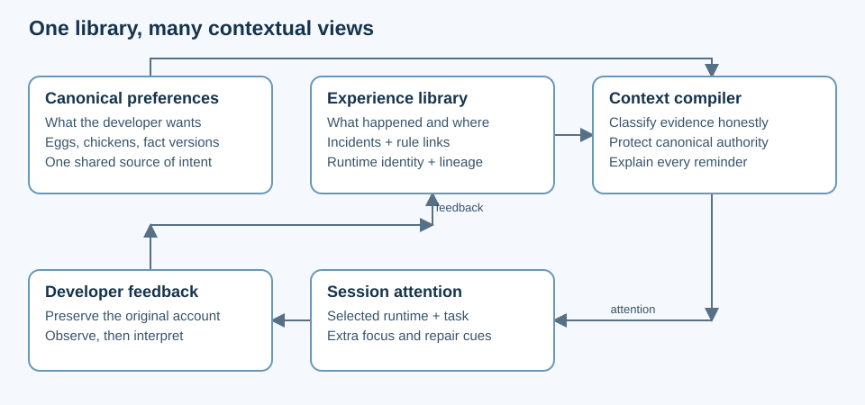

# Context library: preserve preferences, learn from experience

| Status | Scope | Evidence baseline |
|---|---|---|
| Proposal; runtime not implemented | Personal model × harness experience library | Repository revision `d8273f785bc500c9fbaf19d4f8bdcbf974bb8bd3`, inspected 2026-10-17 |

## The product

Keep one canonical basket of what the developer wants, alongside a durable library of what happened. Each model and harness combination gets an explainable view of that library, including special eggs requiring attention; combinations do not get independent copies of preferences.

This follows deveggs' [core principle](../../../README.md#core-principle-deveggs-is-a-harness): preferences reach a session through code (the install block, and the [scout hook](../egg-scout/design.md) in Claude Code and Codex), not an agent's memory. Context views extend that guaranteed baseline; they never replace it.

## What was requested, and what is proposed

| Developer said | Proposed interpretation |
|---|---|
| Preserve preferences across harness/model combinations | Keep canonical eggs and chickens in their current locations |
| Record where things went well or badly | Capture contextual experiences with evidence and exact rule revisions |
| Load special eggs needing attention | Compose a session attention overlay with reasons and supporting experience links |
| Feedback self optimizes a combination | Automatically update diagnosis and attention; require explicit intent before changing a rule or its applicability |
| Model upgrades make this history valuable | Preserve model family and predecessor relationships; inherited evidence is a hypothesis |
| Maintain experiences and frustrations that can eventually be learned from | Save incidents before a preference exists; support later linking without rewriting the original account |

## The library's parts

| Part | Owns | Changes when |
|---|---|---|
| Canonical basket | Current fact, tier, version, architecture, existing lifecycle history | Developer lays, evolves, hatches, cracks or renames an item |
| Experience library | Incident, observed outcome, interpretation, provenance, context, links | An experience or correction is recorded |
| Runtime registry | Harness identity/version, provider/model ID, family and lineage | A runtime is observed or explicitly registered |
| Attention policy | Developer-selected focus rules; compiler version and inclusion limits | Developer adjusts policy |
| Context view | Derived summaries, exact versus inherited evidence, focus reasons | Inputs or selected context change |

Canonical preferences remain authoritative even when feedback indicates poor adherence. A chicken's failure creates a repair priority, never silent permission to ignore it.

## Everyday journeys

| Journey | Interaction | Durable result |
|---|---|---|
| Start a session | Resolve known runtime fields, load baseline, compile session view | Session manifest records inputs and context certainty |
| An egg works | Record linked experience with observed outcome and developer/agent attribution | Evidence joins that exact item version and context |
| A permanent preference is repeatedly missed | Record against the chicken; emphasize a practical reminder | Original chicken stays intact; repair evidence is visible |
| A frustration has no obvious rule | Save an unlinked incident with the developer's words | Searchable experience; diagnosis can be deferred |
| One event involves several rules | Save once, link several item revisions | Per-rule evidence with a single incident identity |
| Change model or harness mid-session | Close the old context segment and compile a new overlay | Feedback points at the segment actually used |
| Upgrade within a family | Show same-family patterns under “inherited hypotheses” | New exact combination begins with no exact evidence |
| Review accumulated frustrations | Group by context, item, failure mode or time | Candidate eggs/repairs with source links, rather than automatic new preferences |

## Authority and automatic adaptation

| Layer | Allowed automatically | Requires explicit developer intent |
|---|---|---|
| Capture | Record clear feedback with provenance and uncertainty | Treating ambiguous sentiment as a positive/negative trial |
| Diagnose | Count attributable observations, flag contradictions and missing metadata | Presenting agent explanations as developer-confirmed causes |
| Attention | Reorder reminders, flag failures, highlight relevant special eggs already in the baseline | Suppress a globally applicable egg because it performed badly |
| Preference | Show proposed tuning and evidence | Evolve, hatch, crack or change applicability |
| Execution | Load declared instructions within existing authority | Execute a script just because an experience mentions it |

Global chickens and applicable eggs always load through the baseline. MVP uses additive attention; all current live rules remain globally loaded. Context-only applicability, selective loading and canonical scope changes are deferred to a separate scope/render/install design; merely observing a harness never makes a rule exclusive to it. Conflict detection blocks a conflicting overlay instruction and explains which canonical rule wins.

## Success and boundaries

| Acceptance criterion | Observable evidence |
|---|---|
| Preferences survive upgrades | Existing baseline has identical canonical facts after a context switch |
| Frustrations are preserved without premature diagnosis | An unlinked mixed-outcome incident can be retrieved before any egg is proposed |
| Combination evidence is honest | Exact, partial, inherited and unknown contexts are visibly separate |
| Learning is explainable | Every attention reason links to source records and the compiler policy |
| Feedback cannot erase developer intent | A bad chicken outcome yields repair attention, with the chicken still loaded |
| Contexts remain isolated | Two concurrent sessions with different models never overwrite one another's views |
| Historical wording stays attributable | A renamed/evolved rule retains old evidence against its old version |

MVP excludes a remote service, model benchmarking leaderboard, automatic model selection, embeddings, transcript ingestion and cross-developer transfer of private experience. Later analysis can consume the same records without changing their provenance.

## Alternatives and the primary open decision

| Option | Trade-off | Recommendation |
|---|---|---|
| Separate basket for every combination | Easy mental model initially; copies drift and migrations multiply | Decline |
| Add only model fields to current trial history | Small change; cannot preserve independent incidents or chicken failures cleanly | Useful compatibility bridge only |
| One canonical basket plus experience records and derived views | Adds a small compiler and registry; preserves intent and evidence independently | **Recommended:** shared truth with contextual learning |

| Primary decision | Recommended starting policy | Other direction |
|---|---|---|
| How much may “self optimization” change automatically? | Automatically rank attention and summarize evidence; propose all rule/applicability changes | Explicit future opt-in could allow narrow contextual overrides with rollback and audit |

This proposal makes the conservative policy concrete so library structure can be assessed now. It does not infer approval for a broader autonomous learning policy.

## Sources and next steps

| Source | Implemented behavior observed | Access |
|---|---|---|
| [Basket model](/Users/jamesgao/Projects/deveggs/src/basket.ts) | Egg version, global counts, observed harness list; feedback rejects chickens; all live rules render | Local revision above; 2026-10-17 |
| [History](/Users/jamesgao/Projects/deveggs/src/history.ts) | Fixed event kinds, date/version, extensible string fields; rename/evolve provenance | Local revision above; 2026-10-17 |
| [Install](/Users/jamesgao/Projects/deveggs/src/install.ts) | One globally managed preference block, import or inline | Local revision above; 2026-10-17 |
| [Store](/Users/jamesgao/Projects/deveggs/src/store.ts) | Separate personal basket repository; writes committed there | Local revision above; 2026-10-17 |
| [Contribution contract](/Users/jamesgao/Projects/deveggs/CONTRIBUTING.md) | Strict TypeScript, no runtime dependencies, CLI/docs consistency | Local revision above; 2026-10-17 |
| [Meta-skill](/Users/jamesgao/Projects/deveggs/skills/deveggs/SKILL.md) | Developer confirmation for new preferences; chicken authority | Local revision above; 2026-10-17 |

Review [contracts and examples](contracts.md), [technical choices](tech-stack.md), then the [implementation plan](implementation.md) and [status board](implementation/status.md). A SPAR review can challenge the unresolved adaptation policy before runtime implementation.
