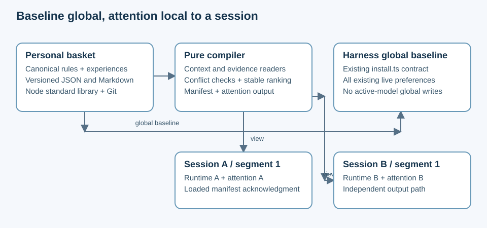

# Proposed implementation plan

## Outcome and execution boundary

| Outcome | Current behavior | Missing work |
|---|---|---|
| Capture one frustration and retrieve it by runtime | Item feedback exists for eggs only | Independent experience commands and registry |
| Start a session with relevant attention | Global preferences load everywhere | Session manifest, compiler and loading instructions |
| Carry lessons into an upgrade honestly | No model lineage model | Explicit lineage and inherited hypothesis labels |

This is a planning package, not feature delivery. All runtime phases below remain unstarted; the primary product decision is the automatic-adaptation boundary in [design.md](design.md).

## Sequence and ownership

| Phase | Work IDs | Dependency | Parallel tracks and join | Exit evidence |
|---|---|---|---|---|
| [1. Durable library](implementation/01-library.md) | CL-1 through CL-4 | Contracts accepted as engineering baseline | Experience storage and context schema can proceed independently; coordinator joins CLI integration | Synthetic capture/retrieve/amend demo; failure recovery tests |
| [2. Attention views](implementation/02-attention.md) | CL-5 through CL-8 | Phase 1 schemas and readers | Pure compiler and session-loading documentation independent; join at manifest/load verification | Two-session isolation, exact/inherited evidence and authority tests |
| [3. Pilot and migration](implementation/03-pilot.md) | CL-9 through CL-12 | Phase 2 working slice | Legacy adapter and sharing exclusions independent; join at full CLI regression | Reversible pilot, legacy parity and privacy exclusion checks |

One coordinator owns the [phase index](implementation/index.md) and [status ledger](implementation/status.md); track owners record verification in their phase files before integration. Architecture review runs at each joined slice, without introducing new human approval gates; any implementation work should follow the user's existing PR and review preferences.

## Proposed command surface

| Proposed command family | Purpose | Compatibility |
|---|---|---|
| `deveggs experience record/list/show` | Capture, search and retrieve linked or unlinked incidents | New, not currently available |
| `deveggs experience amend/link` | Append corrections and later associations | Never rewrite original observation |
| `deveggs context register/show` | Observe runtime and explicit lineage | Unknown metadata allowed |
| `deveggs attention preview/load` | Explain and compose session overlay | Preview has no harness side effects; load is session-native |
| Existing `deveggs feedback` | Preserve legacy egg verdict semantics | No implicit new scoped proof or doubled counters |

Exact flags and final names are implementation details to settle against real CLI use. Model IDs in documentation remain placeholders rather than a bundled model catalog.

## Release and rollback

| Step | Evidence required | Recovery |
|---|---|---|
| Synthetic fixtures | Contract validation, deduplication, corruption handling | Remove temporary fixture basket |
| Opt-in personal pilot | Explicit selected context; inspect manifests and attention | Stop overlay loading; baseline remains |
| Expand supported harness instructions | Demonstrate loading on each actual surface | Report unsupported context/loading capability |
| Release | `npm run check`, doc consistency, PR review and CI | Revert tooling through PR; preserve schema-readable source data |

No personal-library backfill or runtime policy change is performed by this proposal. When the implementation eventually ships in full, move this package under `completed/` and update its links according to `archive-shipped-designs`.
