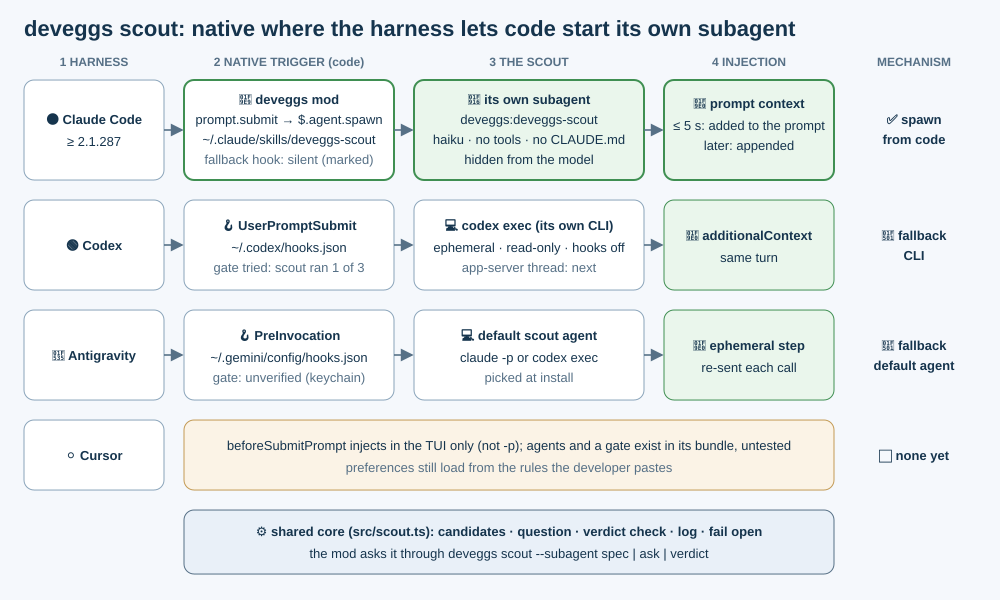
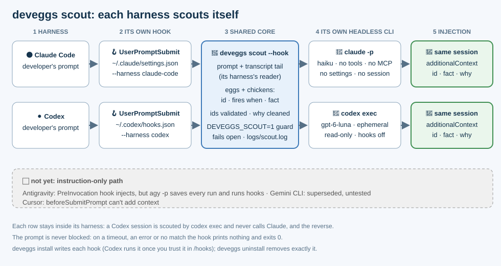

# Egg scout: a fresh-context check on every prompt

| Status | Scope | Harnesses |
|---|---|---|
| Phases 1–3 shipped in #54, phase 5 (native per harness) in #55, phase 6 (default scout agent) in #56; phase 7 (the scout as each harness's own subagent) in this PR | `deveggs scout`, the install-managed hooks, the Claude Code mod, the default scout agent, docs | Claude Code: its own subagent, spawned by code; Codex: its own CLI; Antigravity via the default agent; Gemini CLI and Cursor not yet (instruction-only) |

## Phase 7: the scout as each harness's own subagent

The developer asked for the scout to be **that harness's own subagent** (its subagent mechanism, login and model), started by code, not by the model's choice. Where a harness lets code start its own subagent, deveggs does; elsewhere the hook keeps today's checker, and the table says why.

| Harness | Mechanism shipped | Deterministic how | Scout latency (measured) | Why not more native |
|---|---|---|---|---|
| Claude Code ≥ 2.1.287 | ✅ **spawn from code**: the deveggs mod (`plugins/claude-code/`, linked as `~/.claude/skills/deveggs-scout`) | Its `prompt.submit` hook calls `$.agent.spawn` on every prompt the developer sends; the model can't skip it, and never sees the scout (`agent.offer` hides it) | 1.6–5.1 s (median ~4 s, 10 runs, real 27-item basket, Haiku); `claude -p` fallback 3.0–3.4 s | — |
| Codex 0.161 | 🔁 fallback CLI: `codex exec` from its `UserPromptSubmit` hook (unchanged) | The hook runs on every prompt | 3.9–4.1 s | Hooks can't spawn a subagent (`prompt`/`agent` hook types are parsed but skipped). **Native subagent + gate**, tried live (`~/.codex/agents/deveggs-scout.toml`, a nudge in `additionalContext`, `PreToolUse` deny, `SubagentStop` mark, `Stop` block capped at 2): the scout actually ran in **1 of 3** turns; the other spawns failed or never started, so the gate only nags. **App-server scout thread** (`thread/start` ephemeral + `turn/start`): a true code-started Codex thread with its own `baseInstructions` and `outputSchema`, but 5.7 s cold vs `codex exec`'s ~4 s (3.2–4.4 s warm); injecting into the running TUI's thread is unverified |
| Antigravity 1.4.10 | 🔁 fallback: the default scout agent's CLI from its `PreInvocation` hook (unchanged) | The hook runs on every model call | 2.5–5 s (earlier phase) | Subagents are model-chosen (`invoke_subagent`). Its hooks (`PreToolUse` deny, `Stop` `continue`, built-in continuation caps) and global agents (`~/.gemini/config/agents/<name>.md`) exist in its built-in docs, but a gate couldn't be tested: agy signs in only through the keychain, so not in a throwaway HOME |
| Cursor (cursor-agent 2026.09.10) | ⬜ none yet | — | — | `beforeSubmitPrompt` `additional_context` does reach the model, but only in the TUI (verified live), not `-p`; custom agents (`.cursor/agents/*.md`) and `preToolUse` deny / `stop` `followup_message` exist in its bundle, untested. cursor-agent also imports Claude Code's `~/.claude/settings.json` hooks, so the Claude Code fallback hook may already run there: check that before adding a Cursor hook |

### How Claude Code's mod runs a prompt

| Step | What happens | Bound |
|---|---|---|
| Session start | Asks `deveggs scout --subagent spec` for the definition and registers it: `$.agent.register({name: "deveggs-scout", prompt: SYSTEM_PROMPT, model: "haiku", tools: [], omitClaudeMd: true, maxTurns: 1})`, as `deveggs:deveggs-scout` | No deveggs CLI: no scout, and the fallback hook keeps working |
| Hidden | `agent.offer` withholds it from the model; `tool.check` allows only its spawn (auto mode's classifier would refuse a call no request asked for) | — |
| Each prompt | Only the developer's own (`composer`, `bridge`, `sdk`; not commands, notifications or hidden prompts): `deveggs scout --subagent ask` gets the question from the prompt and `$.session.messages()` (same tail rules as a transcript), then `$.agent.spawn` | — |
| Answer | The scout hands back JSON; the mod answers its `SubagentHandback` call itself (and consumes any message or finish notice from it), so the main model never reads the raw report. `deveggs scout --subagent verdict` checks the ids, writes the context and logs the run (`"checker":"subagent"`) | — |
| Inject | Within `DEVEGGS_SCOUT_WAIT_MS` (5 s, capped at 7 s and at the hook's own 10 s budget): the context joins the prompt (`next({...e, context})`). Later: `$.session.append` adds it to the conversation when it lands | about 5.5 s at most: the wait plus the `ask` and `verdict` calls (~0.2 s each) |
| No double injection | For a prompt it really spawned a scout for, the mod adds `"deveggs_scout": "subagent"` to the `classic.UserPromptSubmit` input; the fallback command hook sees it and exits before calling `claude -p` (verified live: the marked stdin reached the hook and it printed nothing). Belt and braces, since Claude Code skips a user mod's hooks on classic events when the organization's guard mod loads: `--subagent ask` also leaves a per-session stamp (`<basket>/logs/scout-cache/subagent-<session>.json`, the prompt and when, stale after 60 s) the hook checks; a refused spawn takes it back, so the fallback scouts that prompt | — |
| Fail open | Every gating hook has a `.catch` that passes the event on; a refused spawn is logged and the prompt goes ahead | — |

### Phase 7 decisions

| Option | Trade-off | Chosen |
|---|---|---|
| Claude Code: a mod spawning its own subagent | Native model, login and session; started by code on every prompt; needs Claude Code ≥ 2.1.287 | ✅ |
| Claude Code: keep the command hook as the fallback | Older Claude Code, mods turned off or no plugin link still get a scout; a mark keeps it silent while the mod scouts | ✅ |
| Install the mod from a marketplace (`extraKnownMarketplaces` + `enabledPlugins`) | Settings keys and a plugin cache to undo; a cached copy can't find the checkout's `bin/deveggs` | ✗ |
| Install it as a skills-directory plugin (one symlink in `~/.claude/skills`) | Loads in place every session, no settings key; uninstall deletes the link | ✅ |
| Wait for the scout before the prompt goes (as the hook did) | Always in the same turn, but a slow scout holds every prompt | ✗ hybrid: wait up to 5 s, else append |
| "Native subagent + gate" for Codex, Antigravity, Cursor | The model still chooses to spawn; the gate can only deny tools and re-prompt, so a turn can end unscouted; adds a subagent turn plus extra parent calls | ✗ for now: Codex ran the scout in 1 of 3 live turns; Antigravity and Cursor couldn't be tested without reading keychain logins |
| Codex app-server scout thread instead of `codex exec` | Code-started native thread with its own system prompt and schema, but slower cold | ⏭ follow-up |

## Principle: deveggs is a harness layer, native to each harness

deveggs acts as a thin harness layer: it guarantees your preferences are reliably loaded **and noticed** at any point, by code rather than agent memory. `deveggs install` guarantees loading (the managed `PREFERENCES.md` block). The scout hook handles attention: once a session's context gets busy, the main agent stops spotting which egg fires, so a fresh-context model checks every prompt and names the items that apply. The scout runs **inside the harness the developer is using**: the hook is always its own. The checker is its own too wherever it has an isolated headless mode: a Codex session is scouted by `codex exec` and never calls Claude. A harness whose hook can inject but that has no isolated headless mode (Antigravity) borrows the developer's **default scout agent**, picked once per machine at `deveggs install`; Cursor's prompt hook injects only in its TUI and is untested beyond that ([phase 7](#phase-7-the-scout-as-each-harnesss-own-subagent)).

## The problem it fixes

| Observed | Cause | Scout's answer |
|---|---|---|
| Eggs rarely fire in long or complex sessions | 20+ rules sit in a big instructions block; attention goes to the task | A separate model sees only the prompt, a short tail and the rules |
| Rules fire inconsistently between turns | Noticing depends on the agent re-reading its context | It runs on every prompt by hook, not by recall |
| No way to tell whether rules are noticed | No measurement | `logs/scout.log`: harness, latency and ids per run |
| Only Claude Code sessions were scouted (#54) | The checker was hard-wired to `claude -p` | Per-harness adapters: each harness's hook runs its own CLI (#55) |
| Antigravity got no scout (#55) | Its hook can inject, but `agy -p` can't run isolated | Split hook from checker: its own hook, the default scout agent's checker |

## Harness research

Verified on this machine (codex-cli 0.161.0, agy 1.4.10, claude, cursor-agent) against each harness's docs, changelog and live probes, 2026-10-29.

| Harness | Prompt hook + config file | Payload (stdin) | Can inject? Format | Headless checker + isolation | Status |
|---|---|---|---|---|---|
| Claude Code | `UserPromptSubmit` in `~/.claude/settings.json` | `prompt`, `transcript_path`, `session_id`, `cwd` | ✅ `hookSpecificOutput.additionalContext` | `claude -p --model haiku --tools "" --strict-mcp-config --setting-sources "" --disable-slash-commands --no-session-persistence --system-prompt …`; the developer's login | ✅ native (#54) |
| Codex CLI | `UserPromptSubmit` in `~/.codex/hooks.json` (same shape as Claude's; `timeout` in seconds; `features.hooks` is stable and on by default); a new or changed hook runs only once trusted in `/hooks` (Codex keeps its hash in `config.toml`) | `prompt`, `transcript_path`, `session_id`, `cwd`, `turn_id`, `model`, `permission_mode` | ✅ the same `hookSpecificOutput.additionalContext` (plain stdout also works) | `codex exec --ephemeral --ignore-user-config --ignore-rules --disable hooks --sandbox read-only --skip-git-repo-check -c model_reasoning_effort=low -c project_doc_max_bytes=0 --model gpt-6-luna -`; stdout is the final message only; the developer's Codex login (`$CODEX_HOME/auth.json`). No flag drops its tools or system prompt, and `~/.codex/AGENTS.md` still loads, so a preamble tells it to run no tools and ignore standing instructions | ✅ native (this PR); end-to-end verified in a real `codex exec` session with the hook inline (`-c`); the `hooks.json` + `/hooks` trust path waits on the developer's install |
| Antigravity CLI (`agy`) | `PreInvocation` in `~/.gemini/config/hooks.json` (`{"<name>": {"PreInvocation": [entry]}}`, `timeout` in seconds, default 30); fires before **every** model call, `invocationNum` 0 on a new prompt | docs: `invocationNum`, `initialNumSteps`, `conversationId`, `transcriptPath`, `workspacePaths`, `modelName`; agy 1.4.10 also sends `lastUserInput` (verified; wrapped in `<USER_REQUEST>`). The transcript (`USER_INPUT`, `PLANNER_RESPONSE` lines) is undocumented | ✅ `{"injectSteps":[{"ephemeralMessage":…}]}`, verified; but an ephemeral step is gone after the first tool call, so it must be re-sent each invocation | `agy -p --model gemini-3.8-flash-low --disable-slash-commands`: ~5.5 s, ~10 K input tokens. ✗ **not isolated**: no ephemeral flag (every run is saved as a ~450 KB conversation), and hooks run in print mode (verified) with no flag to turn them off. Never called | 🔁 via default (this PR): its own hook, the default scout agent's checker (`claude -p` or `codex exec`) on invocation 0; later invocations re-send the cached context |
| Gemini CLI | `BeforeAgent` in `~/.gemini/settings.json` (timeout in ms) | `prompt`, `session_id`, `transcript_path`, `cwd` | ✅ per docs: `hookSpecificOutput.additionalContext` | `gemini -p` | ⬜ not yet: the docs don't say whether hooks need enabling or what the transcript looks like, it isn't installed here to test, and Antigravity CLI replaced it (June 2026). The default agent could check for it once its hook is verified |
| Cursor | `beforeSubmitPrompt` in `~/.cursor/hooks.json` | `prompt`, `attachments` | ⚠️ the docs say output is only `continue` / `user_message`, but cursor-agent's TUI does read `additional_context` (verified live in phase 7); `-p` never runs the hook | `cursor-agent -p` (~11 s; signs in only through the keychain or an API key, and loads the developer's hooks, so not isolated) | ⬜ not yet ([phase 7](#phase-7-the-scout-as-each-harnesss-own-subagent)) |

The scout's status per harness follows from two questions:

| Can its prompt hook inject context? | Does it have an isolated headless mode? | Scout | Harnesses |
|---|---|---|---|
| ✅ | ✅ | native hook, native checker | Claude Code, Codex |
| ✅ | ✗ | native hook, default scout agent's checker | Antigravity |
| ✗ | any | none: instruction-only | Cursor |

The scout picks the harness from an explicit `--harness` flag the installed hook passes; it never guesses from the environment. A hook without the flag (installed by #54) is Claude Code's.

## The default scout agent

| Question | Answer |
|---|---|
| What is it | The headless CLI (`claude-code` → `claude -p`, `codex` → `codex exec`, or `none`) that checks prompts for a harness without an isolated headless mode of its own. It never overrides a harness's own checker |
| Who picks it | The developer, at `deveggs install`, only when a harness that borrows it (Antigravity) is installed. At a terminal install lists the agents on PATH with what it detected (signed in: `~/.claude.json` has `oauthAccount` or `ANTHROPIC_API_KEY`; `~/.codex/auth.json` or `OPENAI_API_KEY`), recommends none and has no default: Enter alone asks again. Without a terminal (an agent following INSTALL.md) install stops before writing anything with one `needs input:` line, and the agent asks the developer and reruns with `--scout-default`. It never picks silently |
| Where it lives | `deveggs.scoutDefault` in the basket repo's own git config, like `deveggs.autopush`: per machine (which agents are installed differs per machine), never committed or pushed with the basket |
| At hook time | `DEVEGGS_SCOUT_DEFAULT`, else the saved value (install also takes the env var as its answer when there's no flag and nothing saved, without saving it); no default or `none` means no output (fails open). `scout.log` records `checker`: `native`, `fallback:<agent>`, or `fallback` / `fallback:none` with the error |
| Rerun | Shows the saved default without asking; `--scout-default` changes it. `--dry-run` shows the saved, would-be or would-ask default and writes nothing |
| Uninstall | Removes it once no installed hook borrows it (uninstalling `gemini` or `all`) |

### Antigravity's turn

| Invocation | What the hook does | Cost |
|---|---|---|
| `invocationNum` 0 (a new prompt) | Clears the conversation's cached context first (so a check that dies never leaves the last turn's to re-send), reads `lastUserInput` (or the transcript's last `USER_INPUT`) and the transcript tail, runs the default agent's checker, injects `{"injectSteps":[{"ephemeralMessage":…}]}`, caches the context per `conversationId` in `<basket>/logs/scout-cache/` (the developer's own, git-ignored folder, not a shared temp folder another user could pre-create; mode 0600), logs the run | 2.5–5 s |
| `invocationNum` > 0 (later model calls of the same turn) | Re-sends the cached context while the prompt is unchanged, since an ephemeral step lasts one call. Never runs the checker; not logged | ~0.1 s |

## How a run works

| Step | What happens | Bound |
|---|---|---|
| 1. Hook input | The harness pipes `{prompt, transcript_path, session_id, cwd, …}` to `deveggs scout --hook --harness <h>` | `UserPromptSubmit`, timeout 15 s |
| 2. Context | New prompt plus the last ≤6 user/assistant text turns, read by the harness's reader: Claude Code transcript lines (tool calls, results, meta and `<system-reminder>` blocks dropped); Codex rollout `item_completed` `UserMessage`/`AgentMessage` items (the format is undocumented, so any other shape reads as no context) | ≤600 chars a turn, ≤3 KB total, reads only the transcript's last 256 KB |
| 3. Candidates | Every egg and chicken: id, tier, fires-when, fact. Cracked items are left out | the whole basket (27 items ≈ 2 K tokens) |
| 4. Ask | The harness's own checker (research table), else the default scout agent's; run from a temp dir with `DEVEGGS_SCOUT=1` | 12 s (`DEVEGGS_SCOUT_TIMEOUT_MS`); model `DEVEGGS_SCOUT_<CLAUDE\|CODEX>_MODEL`, else `DEVEGGS_SCOUT_MODEL`, else the checker's default |
| 5. Verdict | The reply from its first `{` to its last `}` parsed as `{"apply":[{id,why}]}`; unknown or duplicate ids dropped; each `why` flattened to one plain clause (no backticks or angle brackets, ≤160 chars), since the transcript it read may quote untrusted text | — |
| 6. Inject | The harness's hook output (Claude Code and Codex share `hookSpecificOutput.additionalContext`; Antigravity takes `injectSteps[].ephemeralMessage`): each id, its fact and why, plus "cite them" and (for eggs) "record the trial" | only when something applies |
| 7. Log | One JSON line in `<basket>/logs/scout.log`, with `harness` and `checker` (`native` or `fallback:<agent>`); `logs/.gitignore` keeps it out of the basket's git | always, in hook mode (not Antigravity's re-sends) |

## Adapters

| Part | Shared core (harness-agnostic) | Adapter (per harness) |
|---|---|---|
| Input | `parseHookInput` | `parse`: Claude Code and Codex share `parseHookInput`; Antigravity has `parseAntigravityInput` |
| Transcript | `readTail`, trimming | `transcriptTail` / `codexTranscriptTail` / `antigravityTranscriptTail` |
| Question | `candidates`, `scoutPrompt`, `SYSTEM_PROMPT` | how the instruction reaches the model (`--system-prompt`, or leading the stdin for Codex) |
| Checker | `runHeadless`: temp cwd, guard env, timeout, error text; `CHECKERS` (`askClaude` / `askCodex`, default model, model env var); `resolveChecker` (native, else the default) | `native`: its own `Checker`, or none to borrow the default |
| Verdict | `parseVerdict`, `cleanWhy`, `contextFor` | — |
| Output | fail open, `logRun` | `output` (`hookOutput`, or `antigravityOutput`) |

Adding a harness means an `Adapter` in `ADAPTERS` (`src/scout.ts`) and a `hook` in its `SPECS` entry (`src/install.ts`), and only when its hook can inject context. Without an isolated headless mode, leave `native` out and mark the hook `borrows`: install then asks for the default scout agent.

## Guarantees

| Guarantee | How |
|---|---|
| Native to the harness | The installed hook names its harness; a harness with an isolated headless mode is checked only by its own CLI, with its own login, and never calls another's model. Only a harness without one borrows, and only the agent the developer picked |
| Never blocks a prompt | Every failure in the process (no CLI, timeout, non-zero exit, bad JSON, no basket, an unknown `--harness`, a throw) prints nothing and exits 0; the hook command adds `2>/dev/null \|\| true`, so a missing checkout or `node` stays silent too |
| No recursion | The child gets `DEVEGGS_SCOUT=1`; on top, Claude Code's `--setting-sources ""` and Codex's `--disable hooks` keep the developer's hooks from loading in it |
| Cheap and isolated | Claude Code: no tools, MCP, settings, slash commands, CLAUDE.md or saved session (2–3.5 s). Codex: no saved session, config, hooks or execpolicy; read-only sandbox; low reasoning (4–6.5 s, ~6.5 K tokens, mostly Codex's own system prompt). Antigravity: the same checkers, once per turn; `agy -p` is never called |
| Lightweight setup | `deveggs install` adds one hook entry per harness (`hooks.UserPromptSubmit`, or Antigravity's `deveggs-scout.PreInvocation`) and touches nothing else; `deveggs uninstall` removes exactly it |

## Install footprint

| Situation | install | uninstall |
|---|---|---|
| No hooks file (`settings.json`, `hooks.json`) | Creates it with only the hook | Deletes the file again |
| Other hooks and keys | Appends one group after them, keeps the file's indent (Antigravity: adds its own `deveggs-scout` name after the others) | Removes only its entry; drops a group, array or `hooks` object it left empty (Antigravity: the `deveggs-scout` name once only `enabled` is left) |
| Entry already there (moved checkout, or a #54 hook without `--harness`) | Rewrites its command and timeout in place | — |
| The file isn't a JSON object, or `hooks` / `hooks.UserPromptSubmit` (`deveggs-scout` / `deveggs-scout.PreInvocation`) has an unexpected shape | Skips with a message; never rewrites it | Nothing to do |
| Any rewrite | Atomic (temp file + rename); keeps the indent, but `JSON.stringify` normalises formatting (CRLF becomes LF) | Same |
| Codex | Says the hook runs once trusted in `/hooks` (Codex skips new or changed hooks until then) | Codex keys trust by hook position: removing the scout's group can ask the developer to re-trust a group added after it |
| Antigravity, no default scout agent (none on PATH) | Skips its hook with a message | — |
| Antigravity, `none` picked (`--scout-default none`) | Removes a hook an earlier install added, else skips it | — |
| The default can't be saved (the basket isn't a git repo: no git) | Warns, suggests `DEVEGGS_SCOUT_DEFAULT`, skips the borrowing hook; the rest of install still runs | — |
| Antigravity not installed (no `~/.gemini/antigravity-cli`, `antigravity` or `config`) | No hook, no question | Not looked for |
| A harness without a scout hook (Gemini CLI, Cursor) | One line saying why | — |
| Run from a git worktree | Warns: the hook would go quiet once the worktree is removed | — |

The entry is recognised by its command containing `deveggs scout --hook` (JSON has no comments to hold markers, and unknown keys could fail a harness's settings validation).

## Decisions and alternatives

| Option | Trade-off | Chosen |
|---|---|---|
| Each harness's own headless CLI | Needs an adapter per harness; reuses each harness's auth, no API keys | ✅ native, no cross-vendor calls |
| One checker (`claude -p`) for every harness | One code path, but a Codex developer may have no Claude login, and it sends Codex prompts to another vendor | ✗ (the developer's ask) |
| A default scout agent only where a harness has no isolated headless mode | Antigravity gets a scout; native harnesses are unchanged; the developer picks the vendor once | ✅ (the developer's ask) |
| Pick the default silently (first found) at install | No question, but sends a harness's prompts to a vendor the developer never chose | ✗ ask at a terminal, `needs input:` without one |
| Save the default in the basket (committed) | Syncs across machines, but the agents installed differ per machine | ✗ basket repo's git config, like autopush |
| Detect the harness from env vars | No flag, but guesses can misfire (nested harnesses, `CLAUDE_*` aliases in other harnesses' hooks) | ✗ explicit `--harness` |
| Antigravity checked by `agy -p` | Its own model, but every `agy -p` run is saved as a conversation and runs hooks | ✗ the default agent checks instead, until `agy` has an isolated print mode |
| Antigravity: check on every invocation | Simple, but 2–5 s before every model call of a turn | ✗ check on invocation 0, re-send the cached context after |
| Keyword or embedding match in-process | Instant, but misses intent ("ship it" → `land-via-pr`) | ✗ |
| Async hook | No latency, but can't inject context into the current turn | ✗ defeats the purpose |
| Dry runs logged | Would skew hit-rate numbers | ✗ only hook runs are logged |

[Implementation plan](implementation.md) · [Status](implementation/status.md)
